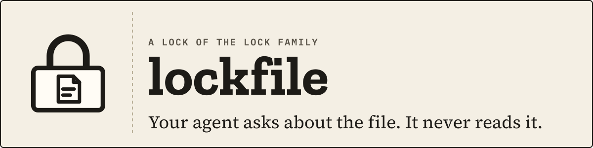
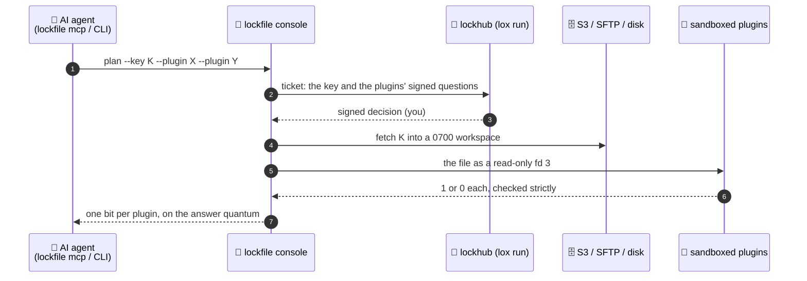

<p align="center">
  <picture>
    <source media="(prefers-color-scheme: dark)" srcset="docs/assets/banner-dark.svg">
    
  </picture>
</p>

<p align="center">
  <a href="https://github.com/DavidGodefroid/lockfile/actions/workflows/ci.yml"></a>
  <a href="https://github.com/DavidGodefroid/lockfile/releases"></a>
  <a href="LICENSE"></a>
  <a href="go.mod"></a>
</p>

<p align="center"><b>Let any AI agent ask yes/no questions about a file it must never read:<br>
signed, sandboxed plugins answer, and the agent only ever gets 1s and 0s.</b></p>

<p align="center">
  
</p>
<p align="center"><sub>An agent (here Claude Code, left) and the lockfile console (right). Drawn before approvals moved to lockhub: today you approve the plan in <code>lox run</code>.</sub></p>

<p align="center">
  <a href="#quick-start">Quick start</a> ·
  <a href="#how-it-works">How it works</a> ·
  <a href="#documentation">Docs</a> ·
  <a href="#the-lock-family">Lock Family</a> ·
  <a href="https://davidgodefroid.github.io/lockfile/">Website</a>
</p>

---

lockfile is a Lock of the [Lock Family](https://github.com/DavidGodefroid/lockfamily),
harness security for AI agents. A **console** sits between your agent and the
files in S3, on SFTP or in a local directory: it fetches the file, runs signed,
sandboxed plugins on it, and returns only each plugin's answer. The agent only asks.

> [!NOTE]
> **Pre-release** (`v0.8.x`): a release may still change the config files,
> the MCP tools or the CLI. Linux only: the plugin sandbox needs Landlock and seccomp.

## Why lockfile

- **The agent never reads the file.** No byte, name, size, type, path or
  listing reaches it: `1`, `0` or no answer, from a closed list.
- **Approval outside the agent.** Each plan becomes a ticket on
  [lockhub](https://github.com/DavidGodefroid/lockhub), and every lockfile plan
  waits for your answer in `lox run`.
- **Fixed, signed questions.** Each plugin answers one question from its
  signed manifest, with no parameters to aim the bit at the content.
- **The code that reads the file is boxed.** Landlock, seccomp and rlimits:
  no network, no path, stdout capped at 3 bytes.

Some files must not reach a model: invoices, contracts, medical letters.
lockfile answers the one question an agent needs about them, and nothing else.

## Install

```sh
brew trust davidgodefroid/tap
brew install davidgodefroid/tap/lox davidgodefroid/tap/lockfile
```

lockfile runs in Docker, on Linux (the formula is Linux only; on Windows, WSL 2
with Docker Desktop). Homebrew installs the `lockfile` launcher, which runs
every command in the release's image. `lox` is lockhub's CLI. The whole
family instead: `brew install davidgodefroid/tap/lockfamily`.

Without Homebrew, the signed install script of a release (needs
[cosign](https://docs.sigstore.dev/cosign/system_config/installation/)):

```sh
V=vX.Y.Z
curl -fsSLO "https://raw.githubusercontent.com/DavidGodefroid/lockfile/$V/scripts/install.sh"
less install.sh
LOCKFILE_VERSION=$V sh install.sh
```

The launcher, its image, Vault, lea and building from source:
[docs/install.md](docs/install.md) and [docs/docker.md](docs/docker.md).

## Quick start

1. In your project, add the file store. `lox add` asks where it is (S3, SFTP
   or a local directory; never a secret), writes the profile, wires your agent
   and starts the console:

   ```sh
   lox add lockfile
   ```

2. Install the plugins you want, then apply them at the console with
   `:review` (`files` is the lock's default name):

   ```sh
   lockfile plugin install file.non-empty@1.0.0
   lockfile plugin install format.is-pdf@1.0.0
   lox attach files
   ```

3. In a terminal of its own, outside any agent, keep `lox run` open. Every
   plan shows up there:

   ```sh
   lox run
   ```

4. Start your agent in the project (`claude`, `codex`, `gemini`, …) and ask
   about a file by its exact key: *"is invoices/2026/10/abc123.pdf a valid PDF?"*

`lox add` wires Claude Code; for Codex, Cursor or Gemini CLI, also run
`lockfile init codex` (or `cursor`, `gemini`). With
[lea](https://github.com/DavidGodefroid/lea), run `lox add` in lea's projects
directory, then `lea stop` and `lea`. Step by step, by hand:
[docs/install.md](docs/install.md#first-plan-step-by-step).

## Highlights

<table>
<tr>
<td width="50%" valign="top">

**🔢 Only 1s and 0s**<br>
Everything the console sends the agent comes from a closed list, checked end
to end over the socket. No size, type, hash, name, listing or error text.

</td>
<td width="50%" valign="top">

**👤 Human in the loop**<br>
Every plan is a ticket you answer in `lox run`, outside the agent. The
screen says how many answers the plan reveals.

</td>
</tr>
<tr>
<td valign="top">

**🔏 cosign everywhere**<br>
Plugins, the marketplace index and lockfile's own releases are checked
against keyless cosign signatures. There is no unsigned mode.

</td>
<td valign="top">

**⏱️ Timing padded**<br>
A run's result leaves the console only at the next multiple of
`answer_quantum` (5 s by default).

</td>
</tr>
</table>

13 official plugins (empty file, PDF header, parses, truncated, blank pages,
fonts, JavaScript, …): [docs/plugins.md](docs/plugins.md). Profiles and every
key: [docs/configuration.md](docs/configuration.md).

## How it works

Two sides in two OS accounts. Only the console touches the file.



1. The agent picks plugins from `lockfile plugins` and plans with the exact
   key it was given. There is no listing and no stat.
2. The console validates the plan without touching the source and sends
   lockhub a ticket; you answer it in `lox run`.
3. The console fetches the file, runs each plugin in its own sandbox and
   returns the answers together, with a handle for follow-up questions.

The approval screen, the agent's commands and MCP tools, and exit codes:
[docs/architecture.md](docs/architecture.md).

## Safety model

- **The console is the enforcement point.** Skills, rules and MCP tool
  descriptions only guide the agent; the console's checks are the guarantee.
- **OS separation.** The console runs as the `lockfile` account in its own
  container; the kernel checks every peer on the socket.
- **Bounded leakage.** `max_plugins_per_handle` (16) caps the answers about one
  file, and each approval states how many a plan reveals.
- **Audit for you only.** Key, size, sha256 and each plugin's outcome go to a
  log only the console account can read. Never file bytes.
- **Known limits.** A plugin that lies about its question is mitigated by
  review and signing, not prevented; `plugin_error` and `fetch_failed` each
  carry one symbol; whoever runs `docker` can reach the console's container.

Every rule and limit: [docs/safety.md](docs/safety.md). Threat model:
[docs/security-model.md](docs/security-model.md).

## Documentation

| Doc | What it covers |
|---|---|
| [docs/install.md](docs/install.md) | Homebrew, the install script, the first plan by hand, upgrade, build, status |
| [docs/docker.md](docs/docker.md) | the setup: image, volumes, seccomp profile, console, agent wiring, what Docker separates |
| [docs/usage.md](docs/usage.md) | every command, profiles, the agent flow, MCP |
| [docs/configuration.md](docs/configuration.md) | profile keys: S3, SFTP, local, credentials, limits; the company's managed configuration ([lockfamily docs/managed.md](https://github.com/DavidGodefroid/lockfamily/blob/main/docs/managed.md)) |
| [docs/architecture.md](docs/architecture.md) | the life of a plan, the approval screen, commands and MCP tools, exit codes |
| [docs/plugins.md](docs/plugins.md) | the official plugins, installing, unofficial marketplaces |
| [docs/plugin-contract.md](docs/plugin-contract.md) | for plugin authors: manifest, runtime, answer, publishing |
| [docs/safety.md](docs/safety.md) | the safety model, in short |
| [docs/security-model.md](docs/security-model.md) | what the agent can see (the exhaustive list), the boundaries, the residual risks |
| [CHANGELOG.md](CHANGELOG.md) | what changed, release by release |

The site, [davidgodefroid.github.io/lockfile](https://davidgodefroid.github.io/lockfile/), is built from [`site/`](site/).

## The Lock Family

| Repo | What it does |
|---|---|
| [lockfamily](https://github.com/DavidGodefroid/lockfamily) | The family site ([lockfamily.dev](https://lockfamily.dev)) and the one-line installer. |
| [locksql](https://github.com/DavidGodefroid/locksql) | SQL databases: the agent queries, PII comes back masked; connections and writes wait for you. |
| [lockmq](https://github.com/DavidGodefroid/lockmq) | RabbitMQ: masked queue inspection; connections, peeks and unmasked reads wait for you. |
| [lockfile](https://github.com/DavidGodefroid/lockfile) | Files (S3, SFTP, disk): the agent asks yes/no questions about files it never reads. |
| [lockhttp](https://github.com/DavidGodefroid/lockhttp) | Outbound HTTP(S): reads of trusted hosts pass; anything that sends data or reaches an unknown host waits for you. |
| [locklog](https://github.com/DavidGodefroid/locklog) | Logs: masked, bounded log search; the agent reads the logs, not the people in them. |
| [lockssh](https://github.com/DavidGodefroid/lockssh) | Commands over SSH: allow-listed commands run at once, the rest waits for you; the key never leaves the console. |
| [lockhub](https://github.com/DavidGodefroid/lockhub) | The approval hub and its `lox` CLI: `lox run` approves outside the agent's harness and never sees values in clear. |
| [lockkit](https://github.com/DavidGodefroid/lockkit) | The shared Go core of every Lock: console, policies, masking, signed tickets, audit, MCP. |
| [lea](https://github.com/DavidGodefroid/lea) | Runs many agents in containers, wired to the Locks. |

## Contributing · Security · License

- **Contributing:** issues and pull requests on
  [GitHub](https://github.com/DavidGodefroid/lockfile). Build with
  `CGO_ENABLED=0 go build ./cmd/lockfile` (Go 1.26+).
- **Docs:** published at [lockfamily.dev/docs](https://lockfamily.dev/docs/)
  from this repo's Markdown. Adding a file under `docs/`, or renaming or
  removing a README H2 section, needs a matching change to
  [lockfamily's `docs-site/nav.toml`](https://github.com/DavidGodefroid/lockfamily/blob/main/docs-site/nav.toml):
  open a lockfamily PR, or the nightly docs build fails.
- **Security:** the threat model and its limits are in
  [docs/security-model.md](docs/security-model.md). To report a
  vulnerability, contact the maintainer
  ([@DavidGodefroid](https://github.com/DavidGodefroid)) privately rather than
  in a public issue.
- **License:** Apache License 2.0, see [LICENSE](LICENSE).
