<p align="center">
  <picture>
    <source media="(prefers-color-scheme: dark)" srcset="site/assets/banner-dark.svg">
    
  </picture>
</p>

<p align="center">
  <a href="https://github.com/DavidGodefroid/lockfile/actions/workflows/ci.yml"></a>
  <a href="https://github.com/DavidGodefroid/lockfile/releases/latest"></a>
  
  
  
  <a href="LICENSE"></a>
</p>

<p align="center">
  <b>Let Claude Code, Codex, Cursor or Gemini CLI check a file it must never see.<br>
  The agent only ever gets 1s and 0s.</b>
</p>

<p align="center">
  <a href="#quick-start">Quick start</a> ·
  <a href="#how-it-works">How it works</a> ·
  <a href="#safety-model">Safety model</a> ·
  <a href="#plugins">Plugins</a> ·
  <a href="#install">Install</a> ·
  <a href="docs/usage.md">Docs</a> ·
  <a href="https://davidgodefroid.github.io/lockfile/">Website</a>
</p>

<p align="center"></p>

---

lockfile lets an AI agent ask **yes/no questions about a file it must never
read**: is this invoice empty, a PDF, does it parse, does it have a blank page,
does it look truncated? A **human-held console**, running in a separate OS
account, fetches the file from S3, SFTP or a local directory, runs signed,
sandboxed plugins on it, and returns only each plugin's answer: `1`, `0`, or
no answer. No byte of the file, its name, size, type or path ever reaches the
agent, and every plan is approved by the human first.

> [!NOTE]
> **Pre-release** (`v0.2.x`). Deployed with Docker; the console needs a
> Linux kernel with Landlock. See [Status](#status).

## Why lockfile?

Some files must not reach a model: invoices, contracts, letters, anything
with personal data. Yet an agent debugging a pipeline often needs one fact
about one of them: did it arrive empty, is it a broken PDF, is a page blank?
Read access answers that and leaks everything else. lockfile answers the
question and nothing else.

| | Agent reads the file | lockfile |
|---|:---:|:---:|
| Agent never sees a byte of the file | ❌ | ✅ |
| Agent never sees the name, size, type or a listing | ❌ | ✅ |
| Agent never holds the storage credentials | ❌ | ✅ |
| A human approves every plan, outside the agent | ❌ | ✅ |
| Every question is fixed and signed in advance | ❌ | ✅ |
| The code that reads the file has no network | ❌ | ✅ |
| Answers released on a fixed time quantum | ❌ | ✅ |
| Append-only audit of every fetch and outcome | ❌ | ✅ |

**Rule: the agent only ever sees 1s and 0s about a file.**

## Highlights

<table>
<tr>
<td width="50%" valign="top">

**🔢 Only 1s and 0s**<br>
Everything the console sends the agent comes from a closed list, checked end
to end over the socket. No size, type, hash, name, listing or error text.

</td>
<td width="50%" valign="top">

**👤 Human in the loop**<br>
Every plan is approved in a console the agent cannot drive, in an OS account
it cannot read. The screen says how many answers the plan reveals.

</td>
</tr>
<tr>
<td valign="top">

**✍️ Signed questions**<br>
Each plugin answers one question fixed in its signed manifest. No
parameters: a parameter would let the agent aim the bit at the content.

</td>
<td valign="top">

**🧱 Sandboxed plugins**<br>
Landlock, seccomp and rlimits: the file as a read-only fd 3, no path, no
network, an empty environment, stdout capped at 3 bytes.

</td>
</tr>
<tr>
<td valign="top">

**🔏 cosign everywhere**<br>
Plugins, the marketplace index and lockfile's own releases are checked
against keyless cosign signatures. There is no unsigned mode.

</td>
<td valign="top">

**⏱️ Timing padded**<br>
A run's result leaves the console only at the next multiple of
`answer_quantum` (5 s by default).

</td>
</tr>
</table>

## Quick start

With Docker on Linux (a kernel with Landlock). The console runs in one
container, your agent's commands in others; they share only the socket volume.
One `lockfile` command, the launcher, runs each of them in the signed release
image. Full guide: [docs/docker.md](docs/docker.md).

```sh
# 1. The launcher and the seccomp profile the console runs under (cosign checks the
#    release and its image; never seccomp=unconfined).
V=vX.Y.Z
curl -fsSLO "https://raw.githubusercontent.com/DavidGodefroid/lockfile/$V/scripts/install.sh"
less install.sh && LOCKFILE_VERSION=$V sh install.sh

# 2. The console account's setup, in its home volume: a profile on a directory
#    mounted read-only, and the plugins (signatures checked with cosign, in the image).
lockfile profile add samples --source local --path /srv/lockfile/samples --prefix invoices/
lockfile plugin install file.non-empty@1.0.0
lockfile plugin install format.is-pdf@1.0.0

# 3. The console, in a terminal you keep in view.
LOCKFILE_DOCKER_ARGS="-v /data/samples:/srv/lockfile/samples:ro" lockfile console --profile samples

# 4. Your agent: wire it (from the project root), then ask.
lockfile init claude
lockfile plan --key invoices/2026/10/abc123.pdf --plugin file.non-empty --plugin format.is-pdf --run --json
```

```json
{"handle":"f_8Kq2xR","answers":[
 {"plugin":"file.non-empty","version":"1.0.0","official":true,"result":1},
 {"plugin":"format.is-pdf","version":"1.0.0","official":true,"result":0}]}
```

The file is not empty and does not start like a PDF. `result: null` with
`"error": "plugin_error"` means the plugin gave no answer: it is **not** a 0.

## How it works

Two sides in two OS accounts. Only the console touches the file.

```
agent account (CLI / MCP)            lockfile account (console, human terminal)
  lockfile plan/run/answers   ──UDS──▶  approve ─▶ fetch ─▶ workspace (0700)
           ▲                    JSON-RPC                       │ fd 3, read-only
           │                                                    ▼
           └────── 1 / 0 per plugin ◀── strict check ◀── sandboxed plugin process
```

1. The agent picks its questions from `lockfile plugins` (each lists its
   question and what 1 and 0 mean) and submits a plan with the exact key it
   was given: `lockfile plan --key K --plugin X…` (or the `lockfile_plan` MCP
   tool). There is no listing and no stat.
2. The console validates the request alone, without touching the source:
   profile, key under the profile's `prefix`, every plugin installed and
   verified, the plugin count within `max_plugins_per_handle`. It shows you
   the approval screen and waits:

   ```
   ╭─ SAMPLES · file plan · 2 answers ─────
   │ requested by uid 1000 (alice) · pid 48211 · exe /usr/local/bin/lockfile
   │ agent: check the invoice reported as blank
   │
   │ key    invoices/2026/10/abc123.pdf
   │
   │ file.non-empty@1.0.0  (official)
   │   ? Does the file contain at least one byte?   1 = size > 0   0 = the file is empty
   │ format.is-pdf@1.0.0  (official)
   │   ? Does the file start like a PDF?   1 = `%PDF-` appears within the first 1024 bytes   0 = no PDF header
   │
   │ this plan reveals at most 2 answers about the file
   ╰─ Approve? [y/N]
   ```

3. On approval (`y`, or the profile name on production) the console fetches
   the file into a fresh `0700` workspace, runs each plugin in its own
   sandbox, checks that it wrote exactly `1` or `0` and exited 0, and returns
   the answers together at the next multiple of `answer_quantum`, with a
   handle (`f_…`) for follow-up questions on the same file.

| Command | MCP tool | What |
|---|---|---|
| `lockfile status` | `lockfile_status` | the running consoles' state |
| `lockfile sources` | `lockfile_sources` | profiles of the running consoles (`busy`: waiting on the human) |
| `lockfile plugins` | `lockfile_plugins` | questions, meaning of 1 and 0 |
| `lockfile plan --key K --plugin X… [--run]` | `lockfile_plan` | ask the human to approve |
| `lockfile run PLAN_ID` | `lockfile_run` | run an approved plan once |
| `lockfile plan --handle H --plugin X… --run` | `lockfile_plan` + `lockfile_run` | follow-up on the same file |
| `lockfile answers HANDLE` | `lockfile_answers` | answers already given |
| `lockfile release HANDLE` | `lockfile_release` | delete the fetched file now |

Exit codes depend on the outcome only, never on an answer: 0 answered, 1 no
console or error, 2 refused, 3 denied or no answer in time, 64 usage. Full
walkthrough: [docs/usage.md](docs/usage.md).

## Safety model

The console is the enforcement point. Skills, rules and MCP tool descriptions
only guide the agent; the console's checks are the guarantee.

- **OS separation.** The console runs as the `lockfile` account in a
  container of its own; the agent's commands run as `agent` (group
  `lockfile-clients`) in others, which share only the socket volume. The
  socket in `/run/lockfile` checks the kernel peer credentials of every
  connection and refuses any other account (`ALLOWED_UIDS` names an agent in
  its own container). Whoever runs `docker` on the host stays outside this
  boundary: see [docs/docker.md](docs/docker.md#what-docker-does-and-does-not-separate).
- **Human approval.** Every plan is approved in the console; no socket method
  approves, installs or loosens anything. On production you type the profile
  name, not `y`. Auto mode switches only from the console's keyboard, never
  on production, never for unofficial plugins.
- **A closed output list.** Everything the console sends the agent is a
  plugin answer, an absence of answer, a random handle or plan id, signed
  plugin metadata, profile names, an approval outcome, a refusal code or the
  console state. Never size, media type, sha256, key listings, names, page or
  byte counts, library or OS error text, per-plugin timing or stderr. The
  end-to-end tests walk every response of every method against this list.
- **Sandboxed plugins.** Landlock (execute and read its own binary only; TCP
  denied with ABI ≥ 4), seccomp (no sockets, `ptrace`, `mount`, `bpf`,
  `keyctl`, second `execve`), rlimits and a wall-clock timeout, an empty
  environment, the file as a read-only fd 3, stdout capped at 3 bytes,
  stderr discarded.
- **Signed everything.** Plugin binaries, manifests, the marketplace index
  and lockfile's releases are checked against keyless cosign signatures. A
  missing cosign refuses; there is no unsigned mode.
- **Bounded leakage.** `max_plugins_per_handle` (16) caps the answers about
  one fetched file, and each approval states how many a plan reveals.
  Results are released on `answer_quantum` (5 s) multiples.
- **Audit for the human only.** Key, size, sha256, fetch cause and each
  plugin's precise outcome go to an audit log only the console account can
  read (`lockfile audit`). Never file bytes.
- **Fetched files** live in a random `0700` workspace, deleted on `release`,
  after `handle_ttl` (30 min), on console exit, and swept at start.

Residual risks: a plugin whose code does not match its question is mitigated
by review and signing, not prevented; `plugin_error` and `fetch_failed` each
carry one symbol that depends on the file; deletion is an unlink, not a
secure erase. Details: [docs/security-model.md](docs/security-model.md).

> [!IMPORTANT]
> "The agent only ever sees 1s and 0s" is the design goal and what the wire
> carries. Plugins' `/proc` entries are a channel to any account sharing
> their pid namespace: the console refuses to run plugins unless no other
> account shares it (in Docker: never `--pid=host`), and older Landlock ABIs
> do not block `fcntl` signals (seccomp does). The `plugin_yanked` refusal is
> listed but not produced yet.

## Configuration

Profiles live in the `lockfile` account's `~/.config/lockfile/config.toml`;
there is no per-project config. `lockfile profile add` appends one,
validated. No file ever holds a secret.

```toml
[profiles.docs]
source = "s3"                 # s3 | sftp | local
bucket = "documents"
region = "eu-west-1"
endpoint = ""                 # S3-compatible server; https:// (http:// only for localhost)
prefix = "invoices/"          # keys outside the prefix are refused
credentials = "vault"         # ask | vault (none: local, or an unencrypted sftp key); no keychain in Docker
vault_path = "secret/data/lockfile/docs"   # username = access key id, password = secret key
production = true             # the profile name is typed for every approval
max_object_bytes = "50MiB"    # larger objects are not fetched
max_plugins_per_handle = 16   # answers revealed about one fetched file, at most
handle_ttl = "30m"            # a fetched file is deleted after this
answer_quantum = "5s"         # results leave the console only on multiples of this
```

SFTP profiles take `host`, `port`, `user`, `auth = "password"` or
`auth = "key"` with `key` (a private key in the `lockfile` account's home
volume, mode 0600 or stricter), `known_hosts` and `base_dir`; local profiles
take `path`, a read-only mount under `/srv/lockfile` in the console's container. See [docs/usage.md](docs/usage.md#profiles-console-account).

## Plugins

A plugin answers **one yes/no question about one file**, fixed in its signed
manifest, about format, structure, integrity or rendering, never about what
the content means or says. Official plugins live in
[lockfile-marketplace](https://github.com/DavidGodefroid/lockfile-marketplace),
whose signer is pinned in the binary. Its source holds 13 plugins:

| Plugin | Question |
|---|---|
| `file.non-empty` | Does the file contain at least one byte? |
| `format.is-pdf` | Does the file start like a PDF? |
| `pdf.parses` | Does the file parse as a PDF without errors? |
| `pdf.truncated` | Does the PDF look truncated? |
| `pdf.encrypted` | Is the PDF encrypted? |
| `pdf.has-blank-page` | Does the PDF have at least one page that paints nothing visible? |
| `pdf.all-pages-blank` | Does every page of the PDF paint nothing visible? |
| `pdf.fonts-not-embedded` | Does the PDF use at least one font that is not embedded? |
| `pdf.has-javascript` | Does the PDF contain JavaScript? |
| `pdf.has-incremental-update` | Was the PDF modified by at least one incremental update after its first save? |
| `pdf.has-non-a4-page` | Does the PDF have at least one page whose visible size is not A4? |
| `pdf.has-rotated-page` | Does the PDF have at least one page with a `/Rotate` other than 0? |
| `pdf.claims-pdfa` | Does the PDF declare PDF/A conformance in its XMP metadata? |

```sh
lockfile plugin install pdf.parses@1.0.0        # exact versions only; signatures checked with cosign
lockfile plugin update pdf.parses@1.1.0         # shows the manifest diff; a changed question needs the name typed
lockfile plugin list | verify [NAME] | remove NAME
lockfile marketplace add NAME --index URL --identity-regexp REGEXP
```

An unofficial marketplace needs its name typed when added, is flagged on
every approval screen and in every agent result, and never runs in auto
mode. **Writing a plugin**: see [docs/plugin-contract.md](docs/plugin-contract.md).

## Documentation

| | |
|---|---|
| 🐳 [docs/docker.md](docs/docker.md) | the setup: image, volumes, seccomp profile, console, agent wiring, what Docker separates |
| 📘 [docs/usage.md](docs/usage.md) | every command, profiles, the agent flow, MCP |
| 🛡️ [docs/security-model.md](docs/security-model.md) | what the agent can see (the exhaustive list), the boundaries, the residual risks |
| 🧩 [docs/plugin-contract.md](docs/plugin-contract.md) | for plugin authors: manifest, runtime, answer, publishing |
| 📝 [CHANGELOG.md](CHANGELOG.md) | what each release contains |
| 🌐 [Website](https://davidgodefroid.github.io/lockfile/) | the same, as pages |

## Install

lockfile runs in Docker. `scripts/install.sh` installs the `lockfile`
launcher and the seccomp profile, after checking with cosign that the release
and its image `ghcr.io/davidgodefroid/lockfile:X.Y.Z` come from lockfile's
release workflow run on that tag; the launcher runs every command in that
image, by its digest. [docs/docker.md](docs/docker.md) covers what runs
where, the volumes, the seccomp profile, the `-vault` image
(`LOCKFILE_VAULT=1`), your own build, `ALLOWED_UIDS` and migrating from a
host install. The base images are pinned by digest, cosign and the Vault CLI
by sha256; the image has no `sudo`.

**Upgrade.** `lockfile update` (same checks), then restart the console; the
volumes keep its state.

## Status

v0.2: console, agent CLI, MCP server and agent wiring on
[lockkit](https://github.com/DavidGodefroid/lockkit), deployed with Docker.
The console needs a Linux kernel with Landlock and seccomp (they sandbox the
plugins).

Roadmap, not in this release: an onboarding wizard (`setup`), a macOS
console, public-key trust roots for unofficial marketplaces.

## The lock family

| | |
|---|---|
| [locksql](https://github.com/DavidGodefroid/locksql) | databases: the agent writes the SQL, you hold the key |
| [lockmq](https://github.com/DavidGodefroid/lockmq) | message queues: the agent inspects your brokers, you hold the key |
| **lockfile** | files: the agent asks yes/no questions and gets 1s and 0s |
| [lockhttp](https://github.com/DavidGodefroid/lockhttp) | outbound HTTP(S): the agent browses, you approve what sends data (pre-release) |
| [lockkit](https://github.com/DavidGodefroid/lockkit) | the shared framework: separated account, socket, console, approval, audit, signed updates |

## Build

```sh
CGO_ENABLED=0 go build ./cmd/lockfile
```

Requires Go 1.26 or later.

## License

Apache-2.0, see [LICENSE](LICENSE).
